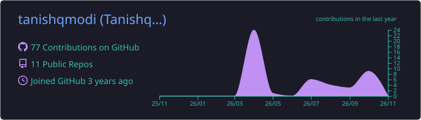
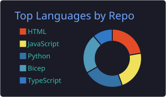
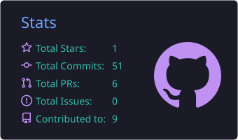

<h1 align="center">Namaste, I'm Tanishq 👋</h1>

  

  
  
  
  

---

## 🚀 About Me

I'm a **Computer Science Engineering student at UPES (Class of 2027)** specializing in **AI/ML and Computer Vision**, and the builder of **[GrowAhead](https://growahead.in)**, an AI-powered career platform. I like taking models out of notebooks and turning them into **production-ready products** that people actually use.

- 🔭 Currently building **GrowAhead**: FitDraft (resume tailoring), SkillPath (learning paths) and JobHunt (job discovery plus an AI agent that applies with your approval)
- 🦅 Built **Avia AI**, a real-time bird-strike detection system for airports
- 🌱 Learning more about **RAG, multi-agent LLM systems and MLOps**
- 👯 Open to collaborating on **AI/ML, Computer Vision and open-source** projects
- 💼 Looking for **AI/ML, Computer Vision or Python Developer** internships
- 💬 Ask me about **Python, FastAPI, Computer Vision and LLM apps**
- ⚡ Fun fact: I speak Hindi, English and a little German

---

## 🛠️ Tech Stack

### Languages

### AI / ML & Data

  
  
  
  
  
  
  
  

### Backend & Frontend

### Desktop Apps

### Databases

### Cloud & DevOps

### Tools

  
  

---

## 🌟 Featured Projects

<table>
  <tr>
    <td width="50%" valign="top">
      <h3>🚀 <a href="https://growahead.in">GrowAhead</a></h3>
      AI-powered career platform: tailors résumés, finds skill gaps, builds learning paths, discovers jobs and applies on your behalf after you review. Runs on the web, macOS (SwiftUI), Windows (Tauri/Rust) and as a Chrome extension.
        
      <code>FastAPI</code> <code>React</code> <code>Node.js</code> <code>PostgreSQL/pgvector</code> <code>Redis</code> <code>Docker</code>
    </td>
    <td width="50%" valign="top">
      <h3>🦅 <a href="https://github.com/tanishqmodi/Avia-AI">Avia AI</a></h3>
      Real-time bird and drone monitoring for airports, with runway intrusion zones, approach-vector alerts and a live multi-camera dashboard.
        
      <code>YOLOv8</code> <code>RT-DETR</code> <code>ByteTrack</code> <code>FastAPI</code> <code>WebSockets</code> <code>React</code>
    </td>
  </tr>
  <tr>
    <td width="50%" valign="top">
      <h3>🎯 <a href="https://github.com/tanishqmodi/skillpath">SkillPath</a></h3>
      Sentiment-aware YouTube learning recommender and AI curriculum planner for Indian students.
        
      <code>React</code> <code>Node/Express</code> <code>YouTube Data API</code> <code>GPT-4o-mini</code> <code>Redis</code>
    </td>
    <td width="50%" valign="top">
      <h3>🩺 <a href="https://github.com/tanishqmodi/Risk-Aware-Multi-Agent-Clinical-Report-Summarization-using-LLMs">Clinical Report Summarizer</a></h3>
      Risk-aware clinical report summarization. Phase 1 turns clinical PDFs into clean, section-aware chunks with OCR fallback.
        
      <code>FastAPI</code> <code>PyMuPDF</code> <code>PaddleOCR</code> <code>spaCy</code> <code>Streamlit</code>
    </td>
  </tr>
  <tr>
    <td width="50%" valign="top">
      <h3>🧑‍🎓 <a href="https://github.com/tanishqmodi/Smart-Attendance-System">Smart Attendance System</a></h3>
      Built for SIH 2025: a custom CNN recognizes faces from a webcam and a proxy-detection pass catches students who leave after marking attendance.
        
      <code>CNN</code> <code>TensorFlow</code> <code>OpenCV</code> <code>Flask</code> <code>Tailwind</code>
    </td>
    <td width="50%" valign="top">
      <h3>🏆 Highlights</h3>
      • <b>IBM Summer Internship</b> (2026): Personalized Learning Path Generation System 
      • <b>Smart India Hackathon</b>: qualified in the UPES internal round, top 40 teams 
      • Interned at <b>Pregrad</b> (2025) and <b>Sapna NGO</b> (2024)
    </td>
  </tr>
</table>

---

## 📊 GitHub Stats

  

  

  
  

  <picture>
    <source media="(prefers-color-scheme: dark)" srcset="https://raw.githubusercontent.com/tanishqmodi/tanishqmodi/output/github-contribution-grid-snake-dark.svg" />
    <source media="(prefers-color-scheme: light)" srcset="https://raw.githubusercontent.com/tanishqmodi/tanishqmodi/output/github-contribution-grid-snake.svg" />
    
  </picture>

---

  <b>Thanks for stopping by! If something here interests you, let's connect.</b> 🙌

